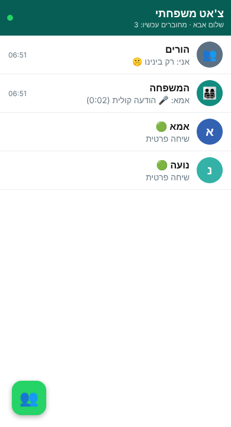
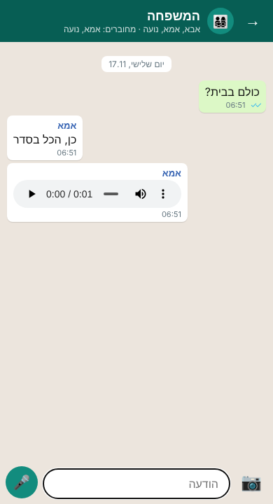

# צ'אט משפחתי – בלי אינטרנט

צ'אט פרטי בסגנון וואטסאפ למשפחה. עובד על רשת Wi-Fi ביתית גם כשאין אינטרנט, ואפשר להתחבר אליו גם מחוץ לבית.

| רשימת שיחות | שיחה |
|---|---|
|  |  |

## יכולות
- 👨‍👩‍👧‍👦 קבוצת "המשפחה", שבה כולם נמצאים אוטומטית
- 💬 שיחות פרטיות בין כל שני בני משפחה
- 👥 קבוצות נוספות (למשל "הורים" או "הילדים"). רק החברים בקבוצה רואים אותה
- 🎤 הודעות קוליות
- 📷 תמונות (מכווצות אוטומטית)
- ✓ ✓✓ אישורי קריאה: ✓ נשלח, ✓✓ אפור נקרא אצל חלק, ✓✓ כחול נקרא אצל כולם. לחיצה על הודעה מראה מי קרא
- 🕓 הודעה שנכתבה בלי חיבור נשלחת אוטומטית כשהחיבור חוזר
- 🟢 רואים מי מחובר עכשיו
- רטט והתראות, מצב כהה, וההיסטוריה נשמרת במחשב

## מה צריך
- **מחשב אחד** (Windows / Mac / Linux) עם [Node.js](https://nodejs.org). **מתקינים מראש, כשיש אינטרנט.**
- **רשת Wi-Fi אחת** שכולם מחוברים אליה, גם בלי אינטרנט:
  - הראוטר בבית, שממשיך לעבוד בלי אינטרנט כל עוד יש חשמל. אם הראוטר מחובר לחשמל דרך UPS או מטען נייד, הוא ימשיך לעבוד גם בהפסקת חשמל. **או**
  - נקודה חמה (Hotspot) מאחד הטלפונים. אפשר להפעיל אותה גם בלי חבילת גלישה.

## הפעלה
1. מעתיקים את התיקייה `family-chat` למחשב.
2. פותחים טרמינל בתיקייה ומריצים:
   ```
   node server.js
   ```
3. מופיעות שתי כתובות. פותחים בכל טלפון את הכתובת שמתחילה ב-**https**, למשל `https://192.168.1.20:8443`.
4. בכניסה הראשונה מופיעה אזהרה "החיבור אינו פרטי". זה תקין, כי התעודה נוצרה במחשב שלכם.
   - **אנדרואיד (Chrome):** "מתקדם" ← "המשך לאתר".
   - **אייפון (Safari):** "הצג פרטים" ← "בקר באתר".
5. כל אחד מקליד את השם שלו. מומלץ לבחור בתפריט הדפדפן "הוספה למסך הבית", ואז הצ'אט נפתח כמו אפליקציה.

> למה https? הדפדפן מאפשר להקליט מהמיקרופון רק בחיבור מאובטח. בכתובת ה-http כל השאר עובד, אבל במקום הקלטה ישירה ייפתח מקליט הטלפון.

## 🌍 שימוש מחוץ לבית
כשאתם מחוץ לבית, הטלפון שלכם צריך דרך להגיע למחשב בבית. יש שלושה מצבים:

**1. יש אינטרנט בבית ויש לכם גלישה בטלפון: Tailscale (חינם, הגדרה של 5 דקות)**
[Tailscale](https://tailscale.com) יוצר "רשת ביתית פרטית" שכל המכשירים שלכם מחוברים אליה מכל מקום, בלי לפתוח פורטים בראוטר.
1. נרשמים לחשבון אחד, למשל עם חשבון Google.
2. מתקינים את Tailscale על המחשב שמריץ את הצ'אט ועל כל הטלפונים, ונכנסים לכולם עם **אותו חשבון**.
3. ב-Tailscale של המחשב מופיעה כתובת שמתחילה ב-`100.`, למשל `100.101.102.103`.
4. בטלפון פותחים `https://100.101.102.103:8443`. זה עובד מכל מקום: בעבודה, ברכב, אצל סבתא.

כדאי לשמור בטלפון שתי סימניות: אחת לכתובת הביתית ואחת לכתובת של Tailscale.

**2. אתם ביחד במקום אחר בלי אינטרנט (מקלט, נסיעה, צימר)**
מפעילים נקודה חמה מטלפון אחד, מחברים אליה את המחשב הנייד ואת שאר הטלפונים, ומריצים `node server.js`. כל ההיסטוריה עוברת יחד עם המחשב.

**3. אתם רחוקים וגם אין אינטרנט בכלל**
במצב כזה שום אפליקציה בטלפון לא יכולה להעביר הודעה למרחק, כי חייבת להיות רשת כלשהי באמצע. אפשרויות לחירום:
- **Briar**: אפליקציה חינמית שמעבירה הודעות בבלוטות' ובוויי-פיי ישירות בין טלפונים, למרחק של עשרות מטרים.
- **Meshtastic**: מכשירי קשר קטנים (LoRa) שמתחברים לטלפון ומעבירים הודעות טקסט למרחק של כמה קילומטרים בלי אינטרנט ובלי סלולר.

## גיבוי ופרטיות
- כל ההודעות נשמרות רק במחשב שלכם: `data.json` ותיקיית `media/`. לגיבוי מעתיקים את שניהם.
- כדי לאפס את הצ'אט מוחקים את `data.json` ואת `media/`.
- אין סיסמאות, וכל מי שמחובר לרשת הביתית וקיבל את הכתובת יכול להיכנס. לכן מתאים לרשת ביתית ול-Tailscale, ולא לרשת ציבורית.
